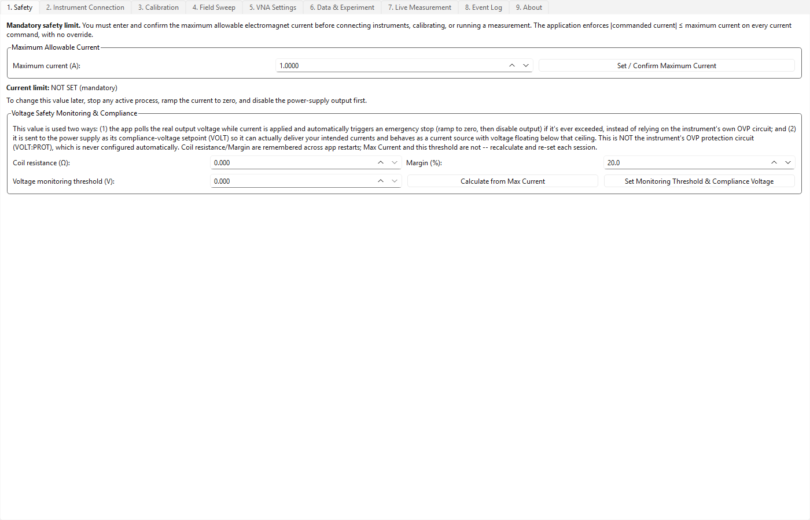
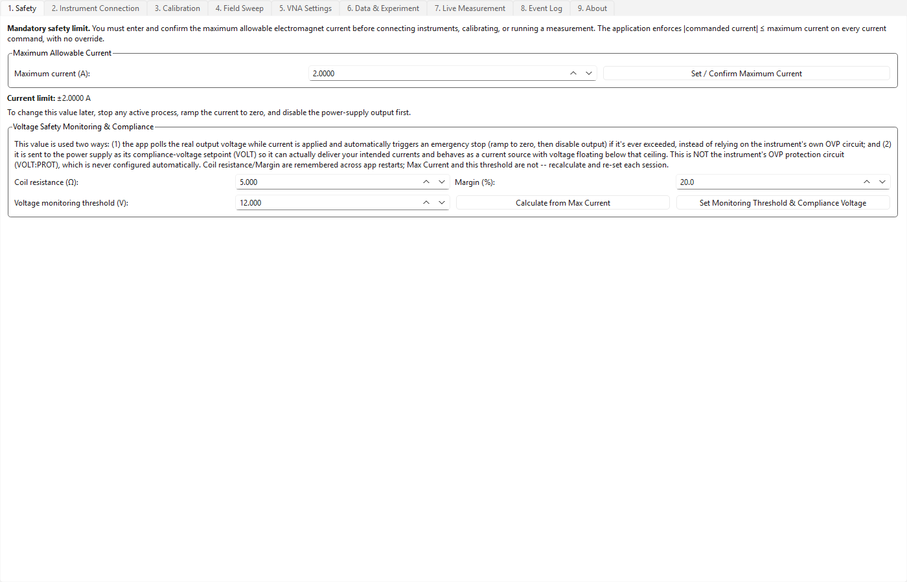
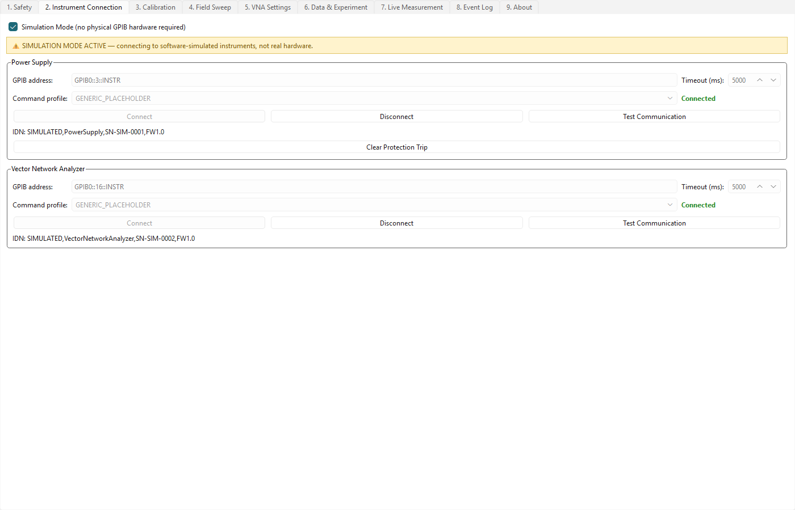
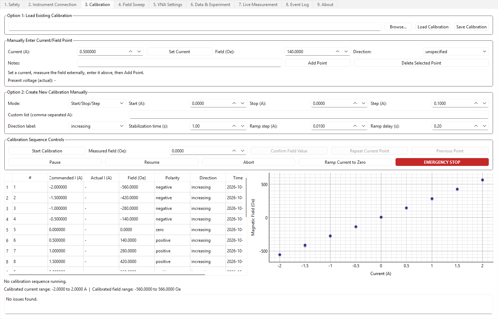
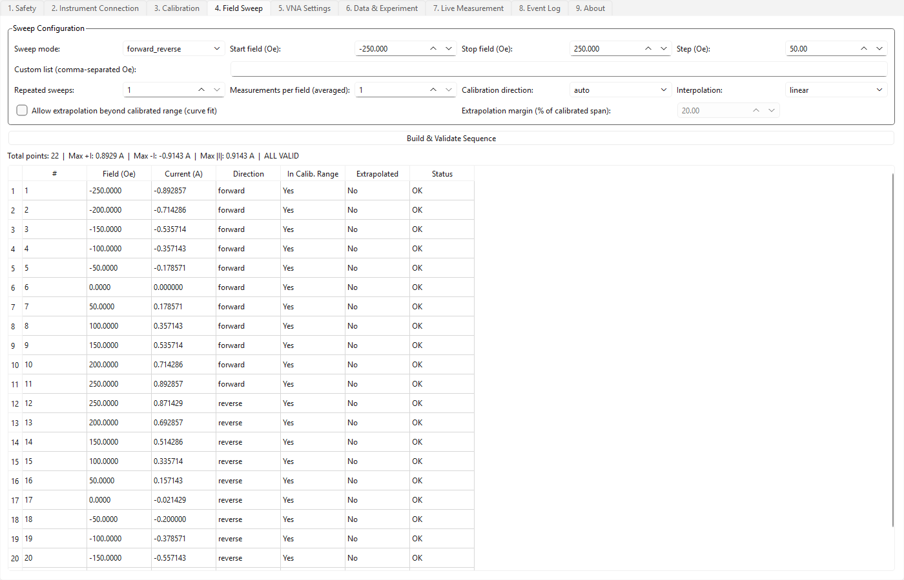
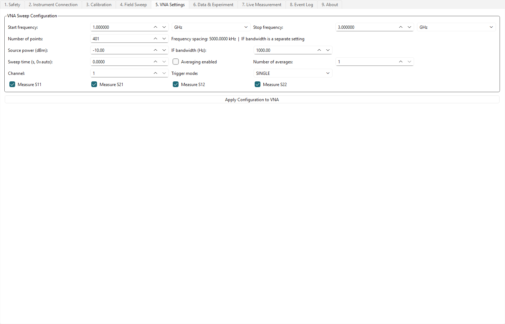
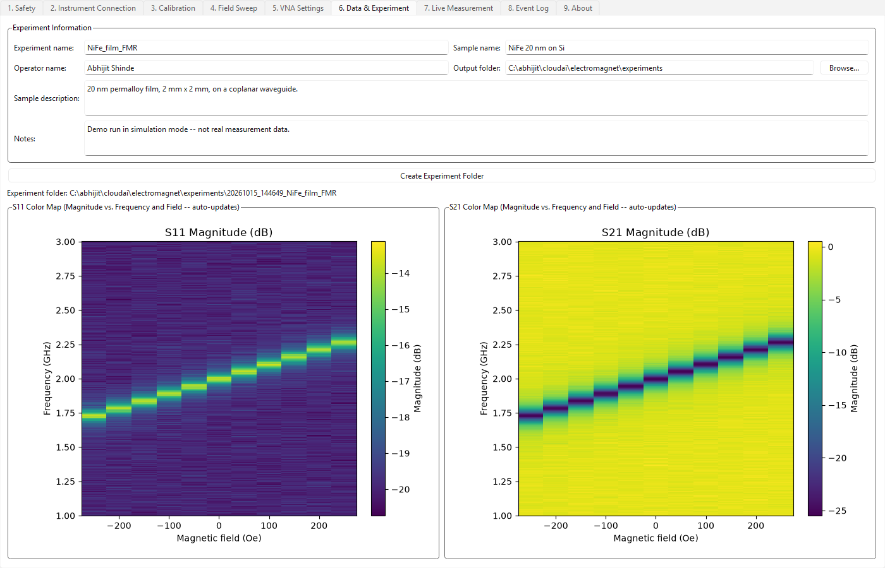
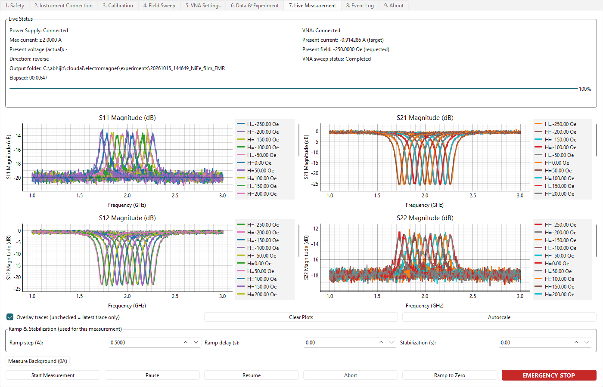
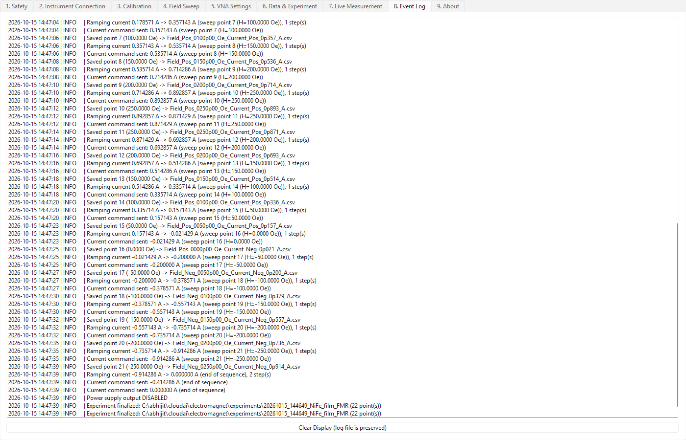
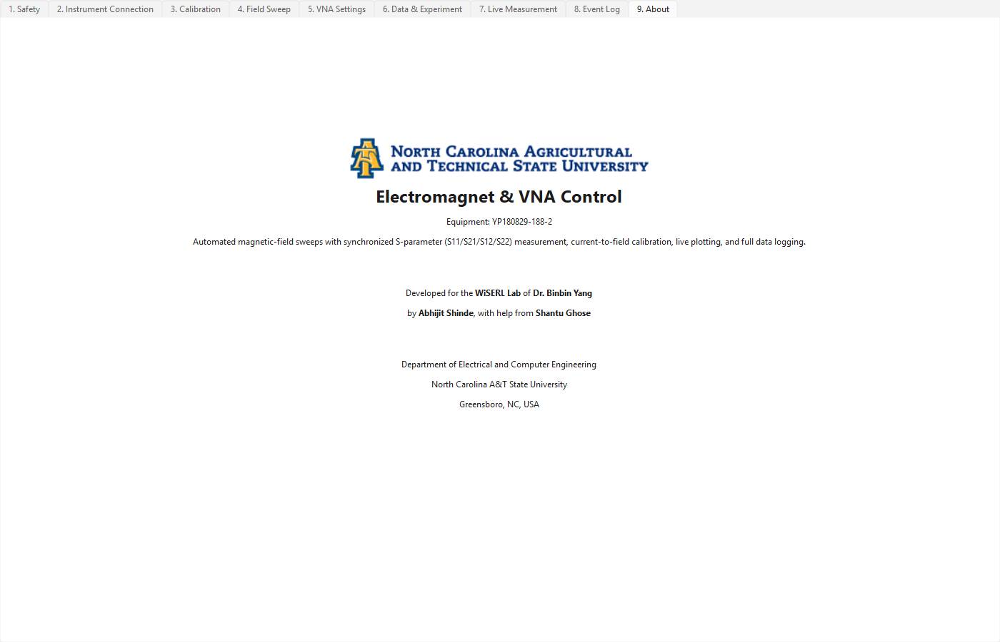

# Electromagnet & VNA Control -- User Manual

Graphical user interface (GUI) guide for the electromagnet + Vector Network
Analyzer measurement station (electromagnet equipment **YP180829-188-2**).

Developed for the **WiSERL Lab** of **Dr. Binbin Yang** by **Abhijit Shinde**,
with help from **Shantu Ghose**. Department of Electrical and Computer
Engineering, North Carolina A&T State University, Greensboro, NC, USA.

> All screenshots in this manual were taken in **Simulation Mode** with
> made-up demo data (a synthetic calibration and a simulated sample), so you
> can follow every step without hardware. Your real numbers will differ.

---

## Contents

1. [What the application does](#1-what-the-application-does)
2. [Starting the application](#2-starting-the-application)
3. [Window layout and the tab order](#3-window-layout-and-the-tab-order)
4. [Quick start: a complete experiment in 10 steps](#4-quick-start-a-complete-experiment-in-10-steps)
5. [Tab reference](#5-tab-reference)
   - [Tab 1 -- Safety](#tab-1----safety)
   - [Tab 2 -- Instrument Connection](#tab-2----instrument-connection)
   - [Tab 3 -- Calibration](#tab-3----calibration)
   - [Tab 4 -- Field Sweep](#tab-4----field-sweep)
   - [Tab 5 -- VNA Settings](#tab-5----vna-settings)
   - [Tab 6 -- Data & Experiment](#tab-6----data--experiment)
   - [Tab 7 -- Live Measurement](#tab-7----live-measurement)
   - [Tab 8 -- Event Log](#tab-8----event-log)
   - [Tab 9 -- About](#tab-9----about)
6. [Stopping, aborting and emergencies](#6-stopping-aborting-and-emergencies)
7. [Where your data goes](#7-where-your-data-goes)
8. [Troubleshooting](#8-troubleshooting)
9. [Known limitations](#9-known-limitations)
10. [Glossary](#10-glossary)

---

## 1. What the application does

The application drives the electromagnet's power supply and the VNA over
GPIB and automates the whole measurement:

1. It converts the **magnetic field** you ask for (in oersted, Oe) into the
   **coil current** (in amperes, A) needed to produce it, using a
   current-to-field **calibration** you load or create.
2. For every field point it ramps the current there safely, waits for it to
   settle, triggers a VNA sweep, and reads back **S11, S21, S12 and S22**
   (magnitude *and* phase).
3. It plots the results live, saves every point to disk the moment it is
   measured, and keeps color maps (magnitude vs. field and frequency) up to
   date automatically.

A **maximum-current limit** that you set first is enforced on every single
current command in the program. There is no override (see
[Tab 1](#tab-1----safety)).

---

## 2. Starting the application

From the project folder, with the project's virtual environment active:

```bash
python -m src.main
```

(If you were given a packaged `ElectromagnetVNAControl.exe`, just
double-click it. See `docs/PACKAGING.md` for how it is built.)

The application starts in **Simulation Mode**: instruments are simulated in
software, so nothing real is driven. This is the safe way to learn the
program or to check a sweep before running it on the magnet. To use the real
hardware, see [Tab 2](#tab-2----instrument-connection).

---

## 3. Window layout and the tab order

The window has nine tabs across the top. They are numbered in the order you
normally use them, left to right:

| # | Tab | Purpose |
|---|-----|---------|
| 1 | Safety | Set the mandatory maximum current; set voltage monitoring/compliance |
| 2 | Instrument Connection | Connect to the power supply and VNA (or simulation) |
| 3 | Calibration | Current -> field table (load, or build one point at a time) |
| 4 | Field Sweep | Define the fields to measure; check they are all reachable and safe |
| 5 | VNA Settings | Frequency range, power, bandwidth, which S-parameters |
| 6 | Data & Experiment | Name the experiment, create its folder, see the color maps |
| 7 | Live Measurement | Run the sweep; live plots; background measurement; stop buttons |
| 8 | Event Log | Running log of everything the program does |
| 9 | About | Credits |

**Tabs 2-7 are greyed out until you set the maximum current on tab 1.**
Safety, Event Log and About are always available.



---

## 4. Quick start: a complete experiment in 10 steps

Use Simulation Mode first. Each step names the tab.

1. **Safety** -- enter the maximum allowable current (e.g. `2.0` A) and click
   **Set / Confirm Maximum Current**. The other tabs unlock.
2. **Instrument Connection** -- leave **Simulation Mode** checked (or
   uncheck it for real hardware) and click **Connect** for the Power Supply
   and for the VNA.
3. **Safety** (again) -- enter the **coil resistance**, click **Calculate
   from Max Current**, then **Set Monitoring Threshold & Compliance
   Voltage**.
4. **Calibration** -- load a calibration file (**Browse...** then **Load
   Calibration**) or build one ([details](#tab-3----calibration)).
5. **Field Sweep** -- choose mode, start, stop and step in oersted, then
   click **Build & Validate Sequence**. Every row must say `OK` and the
   summary must say **ALL VALID**.
6. **VNA Settings** -- set the frequency range and number of points, then
   click **Apply Configuration to VNA** (*after* the VNA is connected).
7. **Data & Experiment** -- type an experiment name, sample name and
   operator, then click **Create Experiment Folder**.
8. **Live Measurement** -- optionally click **Measure Background (0A)** to
   save a zero-field reference.
9. **Live Measurement** -- click **Start Measurement** and confirm. Watch
   the four S-parameter plots fill in.
10. When the "Measurement Finished" box appears, your data is already in the
    experiment folder (path shown on the Data tab and in the Live status
    panel). The output is ramped to 0 A and disabled automatically.

---

## 5. Tab reference

### Tab 1 -- Safety



**Purpose:** set the one number that protects the magnet and supply, and
configure voltage monitoring.

#### Maximum Allowable Current

| Control | What it does |
|---------|--------------|
| **Maximum current (A)** | The absolute ceiling. Every commanded current, in every tab, must satisfy `|I| <= this value`. |
| **Set / Confirm Maximum Current** | Stores the limit and unlocks tabs 2-7. If the power supply is already connected it also writes the same limit to the instrument's own current limit (best-effort). |

The status line shows `Current limit: ±2.0000 A`, or `NOT SET (mandatory)`
until you confirm one. A current command above the limit is *rejected*, not
clipped -- nothing is sent to the supply.

**You cannot change the limit while a process is active or the output is
enabled.** The fields grey out and the status line says why (e.g.
`Locked ... measurement_running`). To change it: stop the calibration or
measurement, click **Ramp Current to Zero**, and make sure the output is
disabled; then the limit can be edited again.

> The maximum current is **not remembered** between sessions on purpose --
> you re-enter it every time you start the program.

#### Voltage Safety Monitoring & Compliance

This box does two jobs with one number:

1. **Software monitoring ceiling.** While current is applied, the app reads
   the supply's real output voltage and triggers an *emergency stop* if it
   ever exceeds this value.
2. **The supply's compliance-voltage setpoint (`VOLT`).** A constant-
   voltage/constant-current supply can only deliver the current you
   command if its voltage setpoint is high enough to regulate on current.
   The same value is therefore sent to the instrument, so it behaves as a
   current source with the actual voltage floating below this ceiling.

It is **not** the instrument's own over-voltage protection (OVP); the app
never configures that.

| Control | What it does |
|---------|--------------|
| **Coil resistance (Ω)** | The electromagnet coil's DC resistance. Remembered between sessions. |
| **Margin (%)** | Head-room added on top of `I x R`. Remembered between sessions. |
| **Voltage monitoring threshold (V)** | The value that will be used. Filled by the button below, or type your own. |
| **Calculate from Max Current** | Computes `max current x coil resistance x (1 + margin/100)`. Example: 2 A x 5 Ω x 1.20 = **12 V**. Nothing is sent yet. |
| **Set Monitoring Threshold & Compliance Voltage** | Stores the threshold and, if the power supply is connected, sends it to the instrument as `VOLT`. A dialog confirms what happened. |

**Notes**

- A threshold of 0 V is refused: it would stop any current from flowing.
  This almost always means the coil resistance is still 0.
- Connecting a new GPIB session resets the supply's voltage setpoint. The
  app therefore **re-applies the threshold automatically every time the
  power supply connects**, as long as you have set a non-zero one.
- The threshold is not remembered across restarts. Recalculate and re-set it
  each session.

---

### Tab 2 -- Instrument Connection



**Purpose:** connect the power supply and the VNA.

| Control | What it does |
|---------|--------------|
| **Simulation Mode** checkbox | Checked: connecting creates software-simulated instruments. A yellow banner is shown while it is on. Unchecked: connecting talks to real GPIB hardware. **Disconnect both instruments before changing this.** |
| **GPIB address** | The VISA resource string, e.g. `GPIB0::3::INSTR` (power supply) and `GPIB0::16::INSTR` (VNA). See `docs/GPIB_ADDRESS_GUIDE.md` to find yours. |
| **Timeout (ms)** | How long to wait for an instrument to reply (100-60000 ms). |
| **Command profile** | Which set of SCPI commands to use. |
| Status | Disconnected (grey), Connecting (amber), Connected (green), Busy (blue), Error (red). |
| **Connect / Disconnect** | Open or close the connection. |
| **Test Communication** | Sends an `*IDN?`-style query and reports OK/FAILED. Enabled only when connected. |
| **IDN** line | The instrument's identification string, shown after connecting. |
| **Clear Protection Trip** (power supply only) | Clears a latched over-voltage/over-current trip. Use it if the output stays off with no other explanation. |

**For real hardware**, pick the matching **Command profile**:

- Power supply: **`AGILENT_E3634A`**
- VNA: **`KEYSIGHT_PNA_X_N5242B`**

The default entry, `GENERIC_PLACEHOLDER`, is only a template for the
simulator and for people adding a new instrument -- it will not control real
hardware. (See `docs/SCPI_REPLACEMENT_GUIDE.md`.)

Once connected, the address, timeout and profile fields lock, because
changing them would not affect the already-open connection. **Disconnect and
reconnect** to apply a change.

On connecting the power supply, the app also sends your maximum current as the
instrument's hardware current limit and re-applies the compliance voltage
from tab 1 (see above).

---

### Tab 3 -- Calibration



**Purpose:** teach the program how much field a given current produces. The
Field Sweep tab uses this table to turn the fields you ask for into
currents.

The calibration is a table of (current, field) points. A good one:

- **covers the whole field range you plan to sweep** (a sweep point outside
  it is rejected unless you allow extrapolation);
- includes both an **increasing** and a **decreasing** current pass if your
  magnet shows hysteresis, so the sweep can use the right branch;
- has at least 2 points (4 or more if you want cubic interpolation).

You can fill the table in three ways.

#### Option 1: Load Existing Calibration

1. Click **Browse...** and choose a `.csv` or `.json` file.
2. Click **Load Calibration**.

The file needs a current column and a field column. Accepted column names
(case-insensitive): current -- `current_a`, `current`, `commanded_current_a`,
`i_a`; field -- `field_oe`, `field`, `h_oe`, `magnetic_field_oe`. Optional
columns: `actual_current_a` (or `actual_current`), `direction` (or
`sweep_direction`), and `notes`. A current that appears twice for the same
direction is reported as a duplicate and only the first is kept.

The table, the plot and the *issues* box fill in at once. Invalid points
(duplicates, missing values, a non-monotonic curve, currents above the
limit) are listed in the issues box and left out.

**Save Calibration** writes the current table to a CSV you choose. Do this
after building a calibration, so you can reload it next time.

#### Manually Enter Current/Field Point

For when you measure the field yourself with a gaussmeter or probe.

1. Type a **Current (A)** and click **Set Current**. The supply ramps to it
   (same safety checks as everything else) and the supply's real output
   voltage is shown in *Present voltage (actual)*.
2. Measure the field with your external instrument and type it into
   **Field (Oe)**.
3. Pick the **Direction** (`increasing`, `decreasing` or `unspecified`),
   optionally add **Notes**, and click **Add Point**.
4. Repeat. Select a table row and click **Delete Selected Point** to remove
   a bad one.

If the instrument's measured current is more than about 10% away from what
you commanded, a **Current Not Holding** warning appears -- see
[Troubleshooting](#8-troubleshooting).

> **The current stays applied after Add Point.** It is not ramped back to
> zero automatically. Click **Ramp Current to Zero** when you are done.

#### Option 2: Create New Calibration Manually (guided sequence)

The program steps through a list of currents and asks you for the field at
each one.

1. Choose **Mode**:
   - **Start/Stop/Step** -- fill **Start (A)**, **Stop (A)**, **Step (A)**.
   - **Custom List** -- type comma-separated currents in **Custom list**,
     e.g. `-1, -0.5, 0, 0.5, 1`.
2. Set **Direction label** (`increasing`/`decreasing`/`unspecified`) -- it
   is stored with every point.
3. Set **Stabilization time (s)** (settling wait after reaching each
   current), **Ramp step (A)** and **Ramp delay (s)** (how gently the
   current is stepped; see the note below).
4. Click **Start Calibration**. Every current is checked against the
   maximum first; if any exceeds it, nothing starts.
5. At each point the program ramps to the current, waits, and shows:
   *"Enter the measured magnetic field corresponding to the presently
   applied current."* Type the value in **Measured field (Oe)** and click
   **Confirm Field Value**. Only then does it advance.

| Button | Effect |
|--------|--------|
| **Confirm Field Value** | Records the field for this current and moves on. |
| **Repeat Current Point** | Re-applies the same current without saving a point (e.g. you mis-read). |
| **Previous Point** | Goes back one point. |
| **Pause / Resume** | Hold and continue the sequence. |
| **Abort** | Stop the sequence. |
| **Ramp Current to Zero** | Ramps the supply to 0 A using the ramp step/delay above. |
| **EMERGENCY STOP** | See [section 6](#6-stopping-aborting-and-emergencies). |

When the sequence ends, the program ramps back to 0 A and disables the
output.

> **Why ramp step / ramp delay matter.** The coil is an inductor. A sudden
> jump in current induces a voltage spike that can trip the supply's
> over-voltage protection and drop the output to zero. Small steps with a
> short delay avoid this. The defaults (0.01 A step, 0.2 s delay) come from
> `config/app_settings.json`.

#### Reading the lower half of the tab

- **Table** -- every point: commanded current, actual (measured) current,
  field, polarity, direction, timestamp.
- **Plot** -- field vs. current for all points.
- **Calibrated current/field range** -- the span the sweep can use without
  extrapolating.
- **Issues box** -- `No issues found.` or a list of problems.

> Save your calibration with **Save Calibration**. When you later click
> **Create Experiment Folder** the current table is also copied into that
> experiment's `calibration/` folder.

---

### Tab 4 -- Field Sweep



**Purpose:** decide which fields to measure and prove every one of them is
reachable and safe *before* anything is energised.

#### Sweep Configuration

| Control | Meaning |
|---------|---------|
| **Sweep mode** | `forward`: start -> stop. `reverse`: stop -> start. `forward_reverse`: up, then back down (the turn-around field is measured twice -- once in each direction). `custom`: exactly the list you type. |
| **Start field / Stop field / Step (Oe)** | The range and spacing. Ignored in `custom` mode. The stop value is always included. |
| **Custom list** | Comma-separated fields in Oe, used only in `custom` mode. |
| **Repeated sweeps** | Repeats the whole list this many times. |
| **Calibration direction** | Which calibration branch converts field to current. `auto`: forward sweep points use the *increasing* branch, reverse points the *decreasing* branch, custom points use all points. `increasing` / `decreasing`: force one branch. `average`: the mean of the two branches. `all`: use every point. |
| **Interpolation** | `linear`, or `cubic` (needs 4+ calibration points on the branch being used, otherwise linear is used). |
| **Allow extrapolation beyond calibrated range (curve fit)** | Off by default. When on, a field outside your calibrated range is converted with a quadratic curve fit instead of being rejected. |
| **Extrapolation margin (%)** | How far beyond the calibrated span extrapolation is allowed (default 20%). Further out is still rejected. |

> **Extrapolation warning.** Electromagnets saturate -- the field flattens at
> high current -- so a fitted point is less trustworthy the further it is
> from your measured data. Enabling it asks you to confirm. Extrapolated
> currents are still held to the maximum-current limit.

#### Build & Validate Sequence

Click it. The program converts every field to a current and fills the table:

| Column | Meaning |
|--------|---------|
| # | Position in the sequence |
| Field (Oe) | Requested field |
| Current (A) | Calculated current (`-` if it could not be computed) |
| Direction | `forward`, `reverse` or `custom` |
| In Calib. Range | Whether the field is inside the calibrated range |
| Extrapolated | `Yes` if it came from the curve fit (row shaded **yellow**) |
| Status | `OK`, or why the point is rejected (row shaded **red**) |

The summary line gives the **total points**, the largest positive and
negative current, the largest |I|, and either **ALL VALID** or **INVALID --
fix before starting**.

**Live Measurement will not start unless the sequence is ALL VALID.** To fix
a red row: change the field range, calibrate further, raise the limit on tab
1 (if it is safe to do so), or enable extrapolation -- then click **Build &
Validate Sequence** again.

> **The built sequence is a snapshot.** If you change the calibration or any
> sweep setting afterwards, click **Build & Validate Sequence** again.

---

### Tab 5 -- VNA Settings



**Purpose:** configure the VNA sweep.

| Control | Meaning |
|---------|---------|
| **Start frequency / Stop frequency** | Value plus a unit drop-down (Hz, kHz, MHz, GHz, THz). Changing the unit converts the number so the frequency does not change. |
| **Number of points** | 2 - 100001. The frequency spacing (kHz) is shown next to it. |
| **Source power (dBm)** | VNA output power, -60 to +30 dBm. Keep it low enough not to drive your sample nonlinear. |
| **IF bandwidth (Hz)** | Receiver bandwidth. Lower = less noise but a slower sweep. |
| **Sweep time (s, 0=auto)** | Fixed sweep time, or `0` to let the VNA choose. |
| **Averaging enabled / Number of averages** | VNA-side averaging for lower noise (slower). |
| **Channel** | VNA channel number (1-32). |
| **Trigger mode** | `SINGLE`, `CONTINUOUS` or `EXTERNAL`. Leave on `SINGLE` for normal use -- the app triggers one sweep per field point. |
| **Measure S11 / S21 / S12 / S22** | Which S-parameters to acquire (all on by default). Unchecked ones are not read, not plotted and not saved. |
| **Apply Configuration to VNA** | Stores the settings and, if the VNA is connected, pushes them to the instrument. |

> **Apply after connecting.** The settings only reach the instrument when you
> click **Apply Configuration to VNA** *while the VNA is connected*. If you
> click it before connecting you only get "Configuration saved. Connect the
> VNA to apply it." -- connect, then click it again. Click it again after any
> change (including toggling the S-parameter checkboxes) and after every
> reconnect. Without it, a measurement fails with "VNA has not been
> configured".

The app does **not** perform a VNA calibration. Do any calibration
(e.g. a full 2-port calibration, which you want for meaningful S12/S22) on
the instrument itself before the experiment.

---

### Tab 6 -- Data & Experiment



**Purpose:** name the experiment, create its folder, and see the field-vs-
frequency color maps build up.

#### Experiment Information

| Field | Meaning |
|-------|---------|
| **Experiment name** | Used in the folder name. |
| **Sample name** | Free text, saved to `metadata.json`. |
| **Operator name** | Free text, saved to `metadata.json`. |
| **Output folder** | Where experiment folders are created. Default is `experiments/` next to the program. **Browse...** to change. |
| **Sample description / Notes** | Free text, saved to `metadata.json`. |

Click **Create Experiment Folder**. This makes a new timestamped folder
(`YYYYMMDD_HHMMSS_<experiment name>`) with its sub-folders, writes
`metadata.json`, records the maximum current, and copies the current
calibration table into it. The full path is shown under the button.

**Do this before you start a measurement or a background measurement** --
they refuse to run without an experiment folder. Clicking the button again
starts a *new* folder (the old one is left untouched on disk) and resets
the color maps.

#### Color maps

Two square plots, **S11** and **S21**, show magnitude (dB) with *field on the
x-axis and frequency on the y-axis*. They **update by themselves** after each
field point is saved -- there is no button to press. Before any data exists
they read "no data yet".

Color maps for **all four** S-parameters (S11, S21, S12, S22) are saved to
the experiment's `plots/` folder as they update, even though only S11 and
S21 are shown on screen.

---

### Tab 7 -- Live Measurement



**Purpose:** run the experiment and watch it.

#### Live Status panel

| Item | Shows |
|------|-------|
| Power Supply / VNA | Connection state |
| Max current | The limit from tab 1 |
| Present current | Target current, and the measured one once a point completes |
| Present voltage (actual) | The supply's *real metered* output voltage (not the compliance setpoint, which a front panel may display instead) |
| Present field | Requested field of the current point |
| Direction | `forward`, `reverse` ... |
| VNA sweep status | The run state: `Running`, `Paused`, `Completed`, `Stopped` or `Error` |
| Output folder | The experiment folder (or a reminder to create one) |
| Elapsed | Time since Start Measurement |
| Progress bar | Points done / total |
| Red warning line | The last error message, if any |

#### The four plots

Top-left **S11**, top-right **S21**, bottom-left **S12**, bottom-right
**S22** -- all magnitude in dB versus frequency in GHz. Each point you
measure adds a trace, labelled `H=<field> Oe` in the legend beside the plot
(10 rows are visible; scroll the legend for more).

- Mouse: drag to pan, scroll wheel to zoom, right-click for the plot menu.
- **Overlay traces** -- checked: keep every trace so you can compare fields.
  Unchecked (default): show only the latest trace. Toggling it clears the
  plots.
- **Clear Plots** -- remove all traces from the screen (saved data is not
  affected).
- **Autoscale** -- reset the axes to fit.

Phase is **not** plotted, but it *is* saved for every S-parameter in the CSV
and HDF5 files.

#### Ramp & Stabilization

| Control | Meaning |
|---------|---------|
| **Ramp step (A)** | Size of each current step when moving between points. |
| **Ramp delay (s)** | Pause between steps. |
| **Stabilization (s)** | Extra wait after reaching each point's current, before the VNA sweep. |

Defaults come from `config/app_settings.json`. The coil's inductance means
smaller steps / longer delays are gentler; larger ones are faster but risk
tripping the supply (see tab 3).

#### Measure Background (0A)

Saves a reference measurement with **no applied field**, separate from the
sweep:

1. The program asks you to confirm.
2. It ramps the current to 0 A, enables the output, triggers one VNA sweep,
   and reads the enabled S-parameters.
3. It saves them to `background/background.csv` and as a `background` group
   in the HDF5 file.

It does **not** disturb the field-sweep data, color maps or cumulative
graphs. It needs both instruments connected, an experiment folder, and a
configured VNA, and cannot be used while a sweep is running. The output is
left enabled at 0 A afterwards.

Typical use: measure it once, before the sweep, so you can later subtract
or normalise the field data against it.

#### Start Measurement

Click **Start Measurement**. The program first checks everything and, if any
condition fails, lists *all* the problems in one dialog:

- maximum current is set;
- power supply and VNA both connected;
- calibration present and valid;
- a field sweep has been built and is **ALL VALID**;
- an experiment folder has been created;
- the VNA has been configured;
- a compliance voltage has been sent to the power supply (needed whenever
  the sweep uses any non-zero current).

It then asks "N field point(s) will be measured ... Proceed?". After you
confirm, for each point in turn the program:

1. ramps the current to the point's value (in the ramp step/delay you set),
2. waits the stabilization time,
3. triggers one VNA sweep and reads S11/S21/S12/S22,
4. reads the actual current and voltage,
5. **writes the point to disk immediately** (per-point CSV, combined CSV,
   HDF5, cumulative graphs, color maps), and
6. adds the traces to the plots.

At the end it ramps to 0 A, disables the output, and shows
"Measurement Finished" with the number of points completed.

#### Run controls

| Button | Effect |
|--------|--------|
| **Pause** / **Resume** | Hold the sequence at the current point and continue later. The current stays applied while paused. |
| **Abort** | Stop the sequence now. The program ramps to zero, disables the output, and keeps all data measured so far. |
| **Ramp to Zero** | Ramp the supply to 0 A using the ramp step/delay above (e.g. after a pause). |
| **EMERGENCY STOP** | See [section 6](#6-stopping-aborting-and-emergencies). |

---

### Tab 8 -- Event Log



A read-only, live list of everything the program does: connections, every
current command, saved points, pauses/aborts/emergency stops, warnings and
errors, file saves, and shutdown.

**Clear Display** only empties this view. The complete log is always kept in
`logs/application.log` and, once you create an experiment, in that
experiment's `event_log.log`.

When something unexpected happens, this is the first place to look.

---

### Tab 9 -- About



Credits and a one-paragraph description of the tool. Always accessible, even
before the maximum current is set.

---

## 6. Stopping, aborting and emergencies

| Situation | Use | What happens |
|-----------|-----|--------------|
| You want to stop for a moment | **Pause** | Sequence holds; current stays applied. **Resume** continues. |
| You want to end the run but keep the data | **Abort** | The program ramps to zero, disables the output, and keeps all points saved so far. |
| You want the current off but stay in the program | **Ramp to Zero** / **Ramp Current to Zero** | Smooth ramp to 0 A. |
| Something is wrong *right now* | **EMERGENCY STOP** (red button, Calibration and Live tabs) | Blocks **all** further current commands, stops the running process, and attempts to disable the output. Confirm on the front panel and in the Event Log that the output is off. |
| Output voltage exceeds the monitoring threshold | (automatic) | The app triggers the same emergency stop on its own and tells you with a **VOLTAGE EMERGENCY STOP** dialog. |

**After an emergency stop, restart the application.** The Safety tab shows
`EMERGENCY STOP ACTIVE`, and the program rejects every current command until
it is restarted -- there is no on-screen button that clears it. Check the
Event Log and the instrument's front panel to confirm the output really is
off before you do anything else.

**Closing the window** while a process is running or the output is enabled
asks for confirmation, then stops the process, ramps to zero, disables the
output, saves all data and disconnects both instruments. It never just quits
with the magnet energised. If it could not *confirm* the shutdown (for
example GPIB communication was lost) it says so in the log -- then check the
instrument manually.

---

## 7. Where your data goes

Each experiment gets its own folder under the output folder:

```
experiments/20261015_144649_NiFe_film_FMR/
  metadata.json                  experiment/sample/operator info, max current,
                                 start and finish time, number of points
  event_log.log                  this experiment's log
  calibration/calibration.csv    copy of the calibration used
  raw/Field_Pos_0100p00_Oe_Current_Pos_0p357_A.csv
                                 one CSV per field point (name encodes the
                                 field and current), written immediately
  processed/combined_data.csv    every point so far, in one table
  processed/experiment_data.h5   HDF5: one group per point + "background"
  background/background.csv      the 0 A reference (if measured)
  graphs/s11_magnitude.png       cumulative overlay of all points, per
  graphs/s21_magnitude.png       S-parameter (magnitude only), refreshed
  graphs/s12_magnitude.png       after every point
  graphs/s22_magnitude.png
  plots/s11_colormap.png         field-vs-frequency color maps, all four
  plots/s21_colormap.png         S-parameters, refreshed after every point
  plots/s12_colormap.png
  plots/s22_colormap.png
```

**CSV columns** (per-point, combined and background files). One row per
frequency point; a block of five columns for each S-parameter you enabled:

| Column | Meaning |
|--------|---------|
| `frequency_hz` | Frequency of the row |
| `requested_field_oe` | Field you asked for (not in the background file) |
| `current_a` | Commanded current |
| `actual_current_a`, `actual_voltage_v` | Measured current and voltage (blank if unavailable) |
| `direction`, `sweep_number` | `forward`/`reverse`/`custom`; repeat index (not in background) |
| `timestamp` | When the point was taken |
| `s11_real`, `s11_imag` | Complex S11 |
| `s11_magnitude` | Linear magnitude |
| `s11_magnitude_db` | Magnitude in dB |
| `s11_phase_deg` | Phase in degrees |
| `s21_*`, `s12_*`, `s22_*` | Same five columns for S21, S12, S22 |

**HDF5 layout:** each field point is a group `point_0000`, `point_0001`, ...
with the field, current, direction, etc. as attributes and datasets
`frequency_hz` and `<sparam>_real` / `<sparam>_imag`. The 0 A reference is a
group named `background`.

---

## 8. Troubleshooting

| Symptom / message | Likely cause and fix |
|-------------------|----------------------|
| Tabs 2-7 are greyed out | The maximum current has not been set. Go to tab 1 and click **Set / Confirm Maximum Current**. |
| **Cannot Change Maximum Current** / the limit field is greyed | A process is running or the output is enabled. Abort, **Ramp Current to Zero**, disable the output. |
| **Connection Failed** | Wrong GPIB address, instrument off, cable/adapter problem, or the wrong **Command profile**. Check `docs/GPIB_ADDRESS_GUIDE.md`; try **Simulation Mode** to confirm the program itself works. |
| Connects, but nothing responds correctly on real hardware | The **Command profile** is still `GENERIC_PLACEHOLDER`. Choose `AGILENT_E3634A` / `KEYSIGHT_PNA_X_N5242B`, disconnect and reconnect. |
| **Invalid Voltage Value** (0 V) | Coil resistance is 0 or no maximum current is set. Fix, click **Calculate from Max Current**, then set again. |
| **Current Not Holding** | The commanded current is not appearing at the instrument. Usually a protection trip (OVP/OCP) or too-low compliance voltage. Click **Clear Protection Trip** on tab 2, and re-click **Set Monitoring Threshold & Compliance Voltage** on tab 1 with the supply connected. Use smaller ramp steps. |
| Output drops to ~0 V right after a large current step | The inductive spike tripped the supply's OVP. Reduce **Ramp step** / increase **Ramp delay**, then **Clear Protection Trip**. |
| **Cannot Start Measurement** | The dialog lists exactly what is missing (limit, connections, calibration, sweep, experiment folder, VNA configuration, compliance voltage). Fix each item. |
| Sweep table has red rows | A field is outside the calibrated range or needs more than the maximum current. See [Tab 4](#tab-4----field-sweep). |
| **VNA has not been configured** | Click **Apply Configuration to VNA** on tab 5 *while the VNA is connected* (see the note there). |
| **Timed out waiting for VNA sweep to complete** | The sweep takes longer than 30 s. Use fewer points, a higher IF bandwidth, or less averaging. |
| **No experiment folder created** | Tab 6 -> **Create Experiment Folder**. |
| Color maps say "no data yet" | No field point has been saved in this experiment folder yet. |
| Plots look empty after switching **Overlay** | Toggling overlay clears the plots; new points will appear as they are measured. |
| **EMERGENCY STOP ACTIVE** on tab 1 | Restart the application (see [section 6](#6-stopping-aborting-and-emergencies)). |
| Something odd happened | Read tab 8 (Event Log) or `logs/application.log`. |

---

## 9. Known limitations

- **"Measurements per field (averaged)" on the Field Sweep tab is not yet
  used** by the measurement code -- changing it has no effect. Use the VNA's
  own **Averaging** on tab 5 instead.
- **The Agilent E3634A is a single-quadrant (unipolar) supply** -- it cannot
  source negative current by itself. A sweep through negative fields needs
  external polarity reversal (a relay or manual reversal of the coil
  leads). See `docs/SCPI_REPLACEMENT_GUIDE.md`.
- The calibration table is **not auto-saved** while you build it. Click
  **Save Calibration** (or create an experiment folder, which copies it).
- A measurement runs one VNA sweep per field point; the sweep must finish
  within 30 s.
- The maximum current and the voltage threshold are intentionally **not**
  remembered between sessions; coil resistance and margin are.

---

## 10. Glossary

| Term | Meaning |
|------|---------|
| **Oe (oersted)** | Unit of magnetic field strength used throughout the app (1 Oe ≈ 79.58 A/m). |
| **A** | Ampere -- the coil current. |
| **S11, S22** | Reflection coefficients at VNA port 1 / port 2. |
| **S21, S12** | Transmission coefficients port 1 -> 2 / port 2 -> 1. |
| **dB** | Decibels; magnitude plots show `20·log10(|S|)`. |
| **IFBW** | Intermediate-frequency bandwidth of the VNA receiver. |
| **Compliance voltage** | The voltage ceiling of a constant-current supply; the supply raises its voltage up to this limit to push the commanded current through the coil. |
| **OVP / OCP** | The instrument's over-voltage / over-current protection circuits. |
| **Background** | A measurement taken at 0 A (no applied field), used as a reference. |
| **Hysteresis** | The field produced at a given current depends on whether the current is increasing or decreasing; hence separate increasing/decreasing calibration branches. |
| **Simulation Mode** | Software-simulated instruments; no hardware is driven. |
